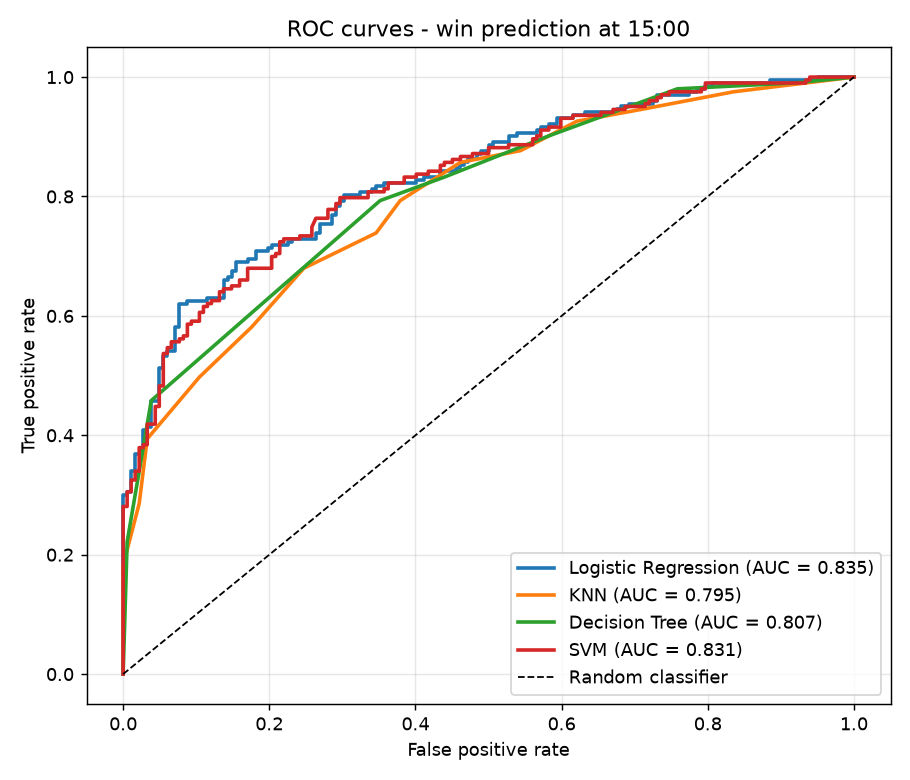
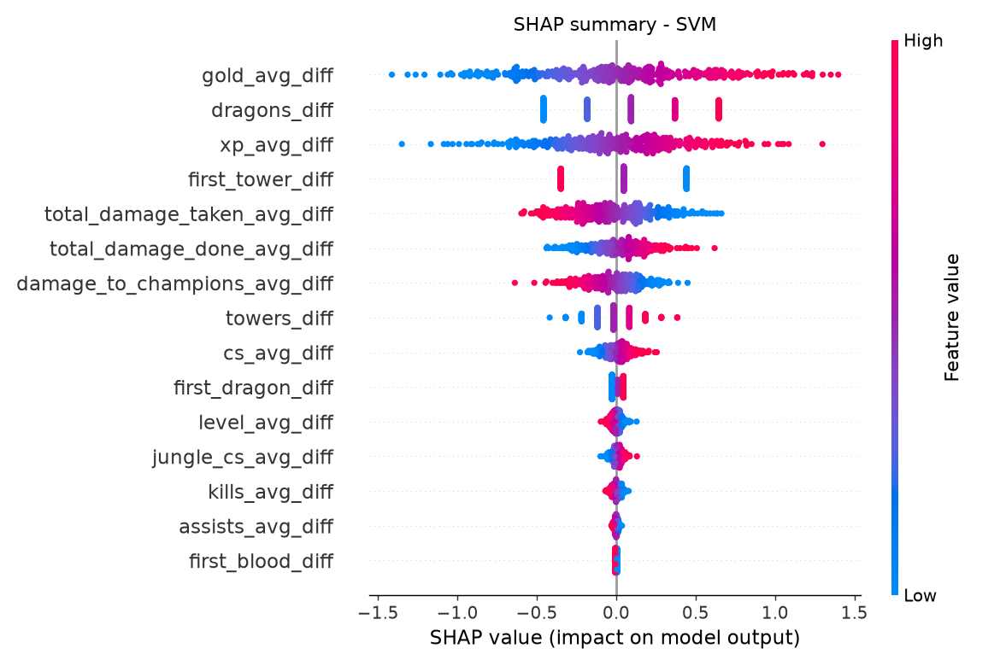

# Predicting League of Legends match outcomes from the first 15 minutes

Machine-learning project for a course at AGH University of Krakow (group project).
The goal is to predict whether a team wins a ranked **League of Legends** match
using only team statistics from the first **15 minutes**, the point at which players
can first vote to surrender.

The project covers the whole workflow: collecting data from the official Riot Games API,
feature engineering, exploratory data analysis, training and tuning four classifiers,
comparing them, and explaining the best model with SHAP. Results are presented in an
interactive Streamlit app.

**Stack:** Python, pandas, NumPy, scikit-learn, imbalanced-learn, SHAP, matplotlib, seaborn, Streamlit, Riot Games API

## Problem

League of Legends is a 5v5 MOBA. Matches in the **Gold** tier (a mid-level rank) are
decided more by macro play (map control, objectives, resources) than by individual
mechanics, so team-level aggregates should carry a strong signal. At 15:00 the surrender
vote unlocks, so a model that estimates the win probability at that moment could support
the decision to keep playing or to concede.

Target: `win_team100` (1 if the blue side won, 0 otherwise). One observation is one match.

## Data pipeline

`api/` and `features/` implement a small, cached data pipeline on top of the Riot Games API:

1. **League entries** (`league-v4`): ranked solo/duo players from a given tier and division (default Gold I, EUNE).
2. **Match IDs** (`match-v5`): recent ranked solo/duo (queue 420) match IDs for each player.
3. **Timelines** (`match-v5 /timeline`): per-player frames and events up to minute 15,
   aggregated per team by `features/extract.py` (gold, CS, jungle CS, level, XP, damage dealt/taken,
   damage to champions, kills, deaths, assists, towers, dragons, first blood / tower / dragon).
4. **Match details**: final result per team.
5. One CSV row per team, saved to `data/output/`.

The client (`api/riot_client.py`) retries on 5xx errors and timeouts, respects `429 Retry-After`,
and every step is checkpointed to `data/cache/`, so an interrupted run can be resumed.

The API key is read from the **`RIOT_API_KEY`** environment variable (a `.env` file in the
repository root is loaded automatically via `python-dotenv`):

```bash
echo "RIOT_API_KEY=RGAPI-..." > .env
python analysis/main.py --num_players 2000 --out data/output/gold_full.csv
```

The collected dataset is committed as `data/output/gold_full.csv`, so **an API key is not
needed to run the analysis**. It contains 3,880 team rows from 1,940 ranked matches
(mostly EUNE); after removing remakes 1,922 matches remain (blue side won 1,014, lost 908).

## Methodology

- **Feature engineering:** for each match, the difference between the two teams
  (team 100 minus team 200) of 15 statistics such as `gold_avg_diff`, `xp_avg_diff`,
  `dragons_diff`, `first_tower_diff`. Vision and Rift Herald features were dropped because
  the API did not return them consistently.
- **Cleaning:** remakes are filtered out (average gold < 1000 or average level < 3).
- **EDA:** distributions, box plots by outcome, class balance, correlation heatmap.
- **Preprocessing:** stratified 80/20 train/test split (`random_state=42`), `StandardScaler`.
  SMOTE oversampling was prepared (`imbalanced-learn`) but is disabled in the final run, because the
  classes are close to balanced (53/47).
- **Models:** Logistic Regression, k-Nearest Neighbours, Decision Tree, Support Vector Machine.
- **Tuning and validation:** `GridSearchCV` with 5-fold cross-validation for each model.
- **Evaluation:** accuracy, precision, recall, F1, ROC AUC, confusion matrices, ROC curves.
- **Interpretability:** SHAP values for the best model (by F1), with summary, bar and waterfall plots.

## Results

Hold-out test set (385 matches), default settings of the Streamlit app:

| Model | Best hyperparameters | CV accuracy | Accuracy | Precision | Recall | F1 | ROC AUC |
|---|---|---|---|---|---|---|---|
| **SVM** | linear kernel, C = 1 | 0.748 | **0.751** | **0.764** | 0.764 | **0.764** | 0.831 |
| Logistic Regression | C = 0.01 | **0.754** | 0.740 | 0.754 | 0.754 | 0.754 | **0.835** |
| Decision Tree | entropy, max depth 3 | 0.737 | 0.725 | 0.716 | **0.793** | 0.752 | 0.807 |
| KNN | k = 15, Manhattan, uniform | 0.747 | 0.699 | 0.704 | 0.739 | 0.721 | 0.795 |

- About **75% of matches can be called correctly at minute 15** from team-level statistics alone.
- The linear models (linear SVM and logistic regression) perform best, which suggests the
  outcome is close to linearly separable in the difference features. The shallow decision tree
  has the highest recall but lower precision; KNN is the weakest.
- **SHAP** (linear SVM): the most important features are the **gold difference**, **dragons taken**,
  **XP difference** and **first tower**. Kills, assists and first blood add little once gold and XP
  are known, since their effect is already captured by the gold lead.
- Practical takeaway for Gold players: a lead in gold and experience at 15:00 is the
  strongest signal, and early objectives (towers, dragons) matter more than individual kills.

<p align="center">
  
  
</p>

The metrics above were reproduced offline from the committed dataset with the same code and
settings as `analysis/projekt.py`. Exact values can vary slightly with library versions and the
test-size slider in the app.

**Limitations:** only one tier (Gold) and one region, no draft or champion information, a snapshot
of a single game patch, and individual outliers (much stronger or weaker players) add noise.

## How to run

Requires Python 3.11+.

```bash
git clone https://github.com/neeflez/lol_analysis_2.git
cd lol_analysis_2
python -m venv .venv && source .venv/bin/activate
pip install -r requirements.txt

streamlit run analysis/projekt.py
```

The app opens at http://localhost:8501 and trains all models on the committed CSV
(no API key needed). The sidebar lets you toggle remake filtering and change the test-set size.

The repository also includes a Dev Container (`.devcontainer/`), so it can be opened in
GitHub Codespaces, where the app starts automatically.

Collecting fresh data (requires `RIOT_API_KEY`, see above):

```bash
python analysis/main.py --num_players 500 --platform EUW1 --tier PLATINUM --division II
python analysis/main.py --help
```

## Project structure

```
.
├── analysis/
│   ├── projekt.py        # Main Streamlit app: EDA, models, comparison, SHAP, conclusions
│   ├── main.py           # CLI entry point for the Riot API data pipeline
│   ├── eda_app.py        # Stand-alone EDA app (extra dependency: plotly)
│   ├── ml_pipeline.py    # Earlier version of the ML app (extra dependency: plotly)
│   ├── app.py            # First prototype of the data collection
│   └── README_EDA.md     # Notes for the EDA app (Polish)
├── api/
│   ├── riot_client.py    # HTTP client with retries and rate-limit handling
│   ├── endpoints.py      # URL builders for league-v4, match-v5, summoner-v4
│   ├── pipeline.py       # Players -> match IDs -> timelines -> outcomes -> CSV
│   └── storage.py        # JSON checkpoints in data/cache/
├── features/
│   └── extract.py        # Team features at minute N from a match timeline
├── stats/                # Side experiment: champion counter statistics scraper and plots
├── data/output/
│   └── gold_full.csv     # Collected dataset (one row per team)
├── docs/                 # Figures used in this README
└── requirements.txt
```

## Note (PL)

Projekt zaliczeniowy z uczenia maszynowego (AGH): przewidywanie wyniku meczu League of Legends
w dywizji Gold na podstawie danych z pierwszych 15 minut gry. Aplikacja Streamlit
(`analysis/projekt.py`) zawiera pełny opis i wnioski po polsku.
